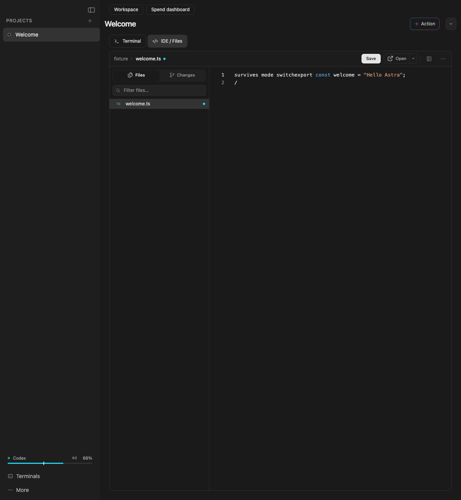

> Superseded for the current candidate by [15 October recovery verification](../recovery-2026-10-15/README.md). Records below describe earlier runs.

> Historical MVP checks from 8 October. The 15 October multi-provider checks are at the top of this file. The earlier provider-connections note it referred to is not present in this repository.

# Verification — 15 October 2026 (multi-provider update)

Branch `codex/ai-dev-editor-mvp`. Changes are uncommitted until the push step below is recorded.

| Check | Result | Evidence |
| --- | --- | --- |
| Rust library suite (`cargo test --lib`) | 1,536 passed, 0 failed, 4 ignored | run log `cargo-final.log` (session scratch) |
| Provider store: round-trip, validation, cap, owner-only file, no credential field, camelCase wire shape | Passed | `providers.rs` tests |
| Connector readiness rules and ledger acceptance of configured kinds | Passed | `provider_connectors.rs`, `spend.rs::accepts_configured_kinds_and_rejects_the_rest` |
| Windows cross-check (`cargo check --target x86_64-pc-windows-gnu`) | Passed; 1 pre-existing warning (`send_cmd`, `hooks.rs`) | session log `cargo-win-final.log` |
| Frontend suite (`vitest run`) | 303 files, 3,357 tests passed | session log `vitest-full-p4.log` |
| TypeScript (`tsc --noEmit`) | Clean | session log `tsc-p4b.log` |

Not verified in this update:

- The macOS Keychain path for saving and checking provider credentials. Unit tests do not reach the OS keychain.
- A native launch of the rebuilt app. The checks above are unit and build verification.
- Live Vertex or DevPass usage. Pullers are not built, so no usage is fetched from either provider.
- The browser fixture `evidence/browser-check.mjs`. Its demo steps were removed, but it has not been rerun.

Changes in this update: provider settings panel; provider store and connector rules; Send AI footer shows a waiting row for each enabled subscription; dashboard shows a per-provider status strip and no longer says "Hermes spend"; the demo seed and screenshot were removed.

---

# Verification — 8 October 2026

Source starts from upstream `32081e66572dae5d54fb15513ebe913fd53c90b9`. Local branch: `codex/ai-dev-editor-mvp`. The requested GitHub fork exists at https://github.com/DanielHarris69/ai-dev-editor, accessed with an existing personal account without changing the active managed-account login. Local changes remain uncommitted and unpushed, per repository instructions. Binary identity and modified-source hashes are in `evidence/`.

| Check | Result | Evidence |
| --- | --- | --- |
| Frontend TypeScript + Vite production build | Passed through final Tauri build | `evidence/macos-build.log` |
| Full frontend suite | 301 files, 3,348 tests passed | `evidence/frontend-tests.log` |
| Full Rust library suite | 1,515 passed, 3 ignored | `evidence/rust-tests.log` |
| SQLite persistence/source separation/deduplication/input validation | Passed | Tests in `spend.rs` and full Rust log |
| Real loopback HTTP mock + usage ingestion + authentication | Passed against an ephemeral listener and temporary DB | Test in `spend_proxy.rs` and full Rust log |
| Windows cross-compilation check | Passed with MinGW, Windows GNU target and sidecar placeholder | `evidence/windows-check.log` |
| macOS Apple Silicon `.app` bundle | Passed, unsigned local candidate | `evidence/macos-build.log`, `evidence/build-identity.json` |
| Bundled native app startup + schema + unauthorized write rejection | Passed with isolated temporary data | `evidence/native-smoke.py`, `evidence/native-smoke.json` |
| App survives occupied proxy port | Passed | `evidence/native-smoke.json` |
| Existing LPM CLI symlink preserved | Passed before/after native smoke | `evidence/native-smoke.json` |
| Browser fixture: spend/demo separation, Monaco file load/edit and draft retention across Terminal/IDE switching | Passed, no page errors | `evidence/browser-check.mjs`, `evidence/browser-check.json` |
| Diff whitespace check | Passed | `git diff --check` |

The browser screenshots use synthetic IPC fixtures; they verify rendering and frontend interactions rather than native IPC. Native backend tests and the bundled-app smoke independently cover the backend. No real API calls, spending, provider-key configuration, billing ingestion, GitHub push, app installation, or modifications to the existing LPM checkout were performed.

The macOS app is `desktop/frontend/src-tauri/target/release/bundle/macos/Astra Dev Editor.app`. It can be launched locally; it has not been signed or notarized. The binary is 38,796,944 bytes, SHA256 `ba8fe742c06796ad434651f3783782d7f0ccb597e6a9f4a3c964502c08cf63ba`.

## Remaining limits

- Windows cross-check uses an empty sidecar placeholder for Tauri metadata; it is not a Windows installer or runtime test. Native Windows and Linux packaging/UI/PTY acceptance remains unverified.
- Automatic provider collectors and authenticated upstream API forwarding are not implemented. This MVP provides the requested mock route and an additional validated route to accept usage/cost from integrations. It cannot retrospectively measure Gemini app conversations.
- API costs are reported by integrations, not independently reconciled against bills; there is no price catalog or inferred subscription dollar cost.
- LPM's existing manual CLI/hook/skill installation and platform-specific uninstall tooling require separate namespacing before general distribution. Startup chores are disabled for this derivative; users should avoid those inherited install controls.
- The inherited npm dependency tree reports six advisories: two low, two moderate and two high, captured in `evidence/npm-audit.json`. One PDF dependency upgrade is a major-version change, so it was not silently forced as part of this MVP. Treat the bundle as a local development candidate pending dependency remediation and distribution review.

## Synthetic screen previews

